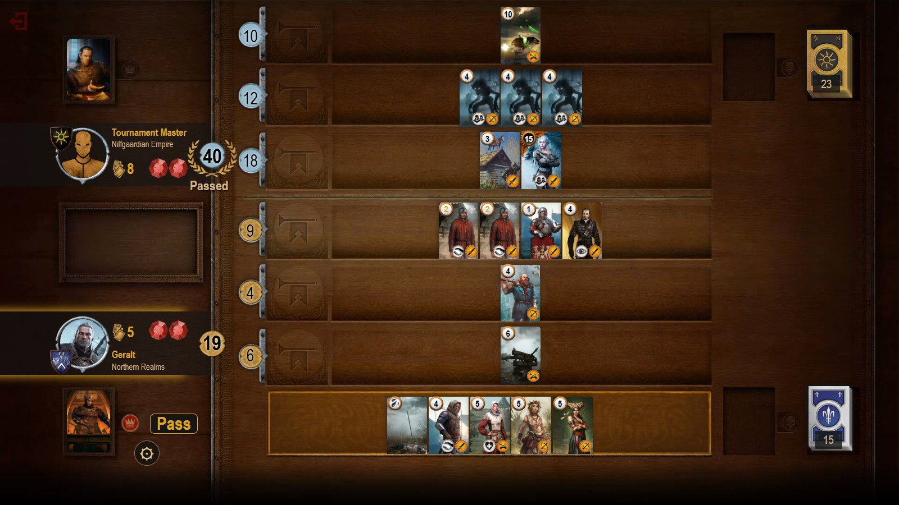
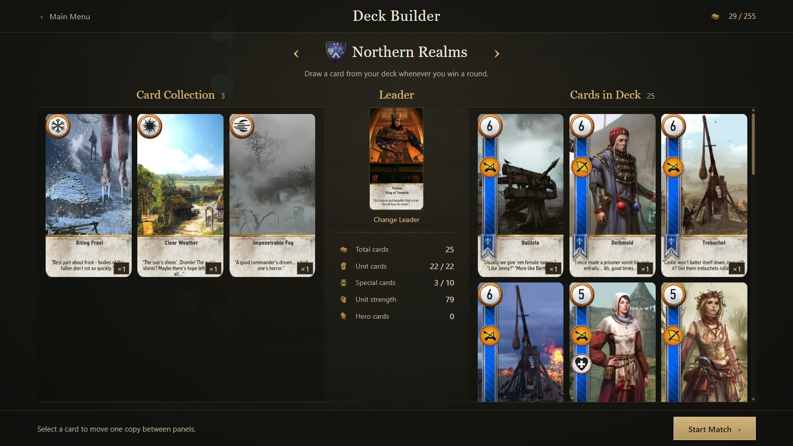
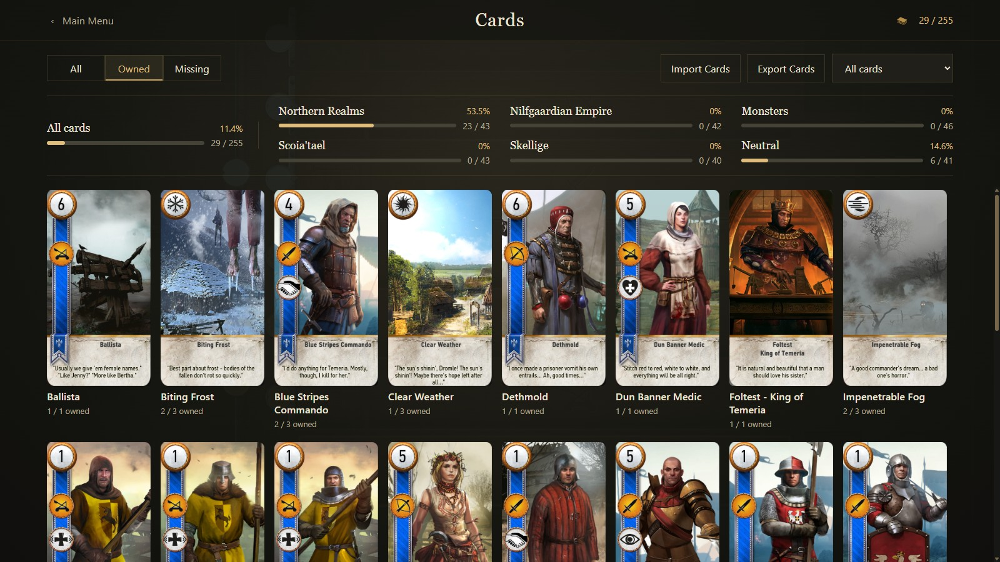

# Gwent Classic for Windows / Android

Play the Gwent minigame from *The Witcher 3: Wild Hunt* on Windows and Android. Start with Northern Realms and build your collection across five factions. Play solo against the AI or challenge a friend over LAN. A Windows PC and an Android phone can play at the same table, and either player can host.

## Download

| Edition | How to play |
| --- | --- |
| [Android APK](https://github.com/CozyPufna33/gwent-classic-windows/releases/latest/download/Gwent-Classic-1.0.0-Android.apk) | Open the APK on a phone or tablet running Android 9 or later, tap **Install**, and play in landscape. |
| [Windows installer](https://github.com/CozyPufna33/gwent-classic-windows/releases/latest/download/Gwent-Classic-1.0.0-Setup.exe) | Run Setup and open **Gwent Classic** from the Start menu. The installer uses your Windows account and offers an optional desktop shortcut. |
| [Portable RAR](https://github.com/CozyPufna33/gwent-classic-windows/releases/latest/download/Gwent-Classic-1.0.0-Portable.rar) | Extract the entire **Gwent Classic** folder to a writable location and double-click **Gwent.exe**. |

The Windows editions require 64-bit Windows, .NET Framework 4.6.2 or later, and the Microsoft Edge WebView2 Runtime. On Android, use an up-to-date Android System WebView. All editions include the card art, music and sound effects. [WebView2 Runtime](https://developer.microsoft.com/en-us/microsoft-edge/webview2/) · [Release notes and SHA-256 checksums](https://github.com/CozyPufna33/gwent-classic-windows/releases/latest)

## Screenshots

| Build a Northern Realms deck | Track your collection across factions |
| --- | --- |
|  |  |

## Play

- **Solo.** Choose **New Game**, edit your deck and start the match. **Settings** lets you pick the AI difficulty and opposing faction.
- **LAN.** Connect both devices to the same home network. One player selects **Multiplayer → Host LAN Game**. The other enters the displayed IPv4 address and selects **Join LAN Game**. Both choose a deck and select **Ready**.
- **Collect.** A victory offers up to three cards. Choose one for your collection. **Cards** tracks progress across all 255 collectible copies and shows which faction collections are complete.
- **Profiles.** Enter a user name in the main menu to save your collection, decks, settings and match record. Use **Cards → Export Cards** and **Import Cards** to share a collection between profiles. On Windows, personal saves live in `Profil` beside the executable. Android stores profiles in the app’s local data.

Click or tap a card, then select a highlighted row or target to play it. On Windows, press **Space** to pass, **X** to use your leader and **F11** to toggle fullscreen. [Full game guide](GAME-GUIDE.md)

## Build and test

From PowerShell on 64-bit Windows, run `.\Packaging\Build.ps1` to compile the launcher. The project includes the WebView2 SDK libraries and uses the .NET Framework C# compiler supplied with Windows.

To build both Windows editions, run `.\Packaging\Build.ps1 -Packages -Rar 'C:\Program Files\WinRAR\Rar.exe' -Iscc 'C:\Program Files (x86)\Inno Setup 6\ISCC.exe'`. The script writes the RAR, installer and checksums to `dist\`.

With Node.js 22 or later, run `node Tests/catalogue.cjs` for catalogue and reward checks. On Windows, `.\Tests\windows-smoke.ps1` and `.\Tests\lan-smoke.ps1` exercise the desktop application using temporary profiles.

## Credits

This unofficial fan game adapts Arun Sundaram’s *Gwent Classic*. The Witcher, Gwent and original artwork belong to their respective rights holders. The game includes third-party music, effects and Microsoft WebView2 components. [Sources and credits](GAME-GUIDE.md#sources-and-credits) · [Gwent Classic licence](Game/LICENSE) · [WebView2 licence](Native/WebView2-LICENSE.txt) · [WebView2 notices](Native/WebView2-NOTICE.txt)
